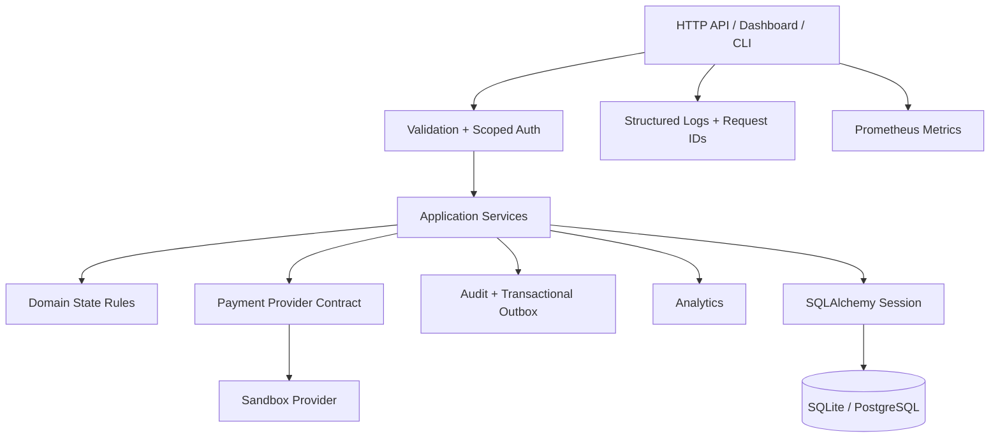

# RobIA Ops

**RobIA Ops** é a evolução técnica do repositório `Projeto-python-rob-IA` para uma plataforma coerente de **operações de colaboradores, folha, pagamentos sandbox, auditoria, observabilidade e analytics explicáveis**.

> O baseline original misturava Flask, Django, PyQt, TensorFlow, PyTorch e duas camadas ORM sem um fluxo integrado. O material recebido continua preservado em `legacy/original/`; a aplicação principal v3 é independente, testável e preparada para evolução incremental.

## Destaques da v3

- API REST versionada com FastAPI (`/api/v1`)
- SQLAlchemy 2 + Alembic + SQLite/PostgreSQL
- colaboradores com identificadores públicos UUID e versionamento otimista
- **CPF completo não é persistido**: a v3 grava HMAC keyed + dois últimos dígitos
- chaves de API com escopos `read`, `write` e `admin`, mantendo compatibilidade com a chave única v2
- folha tratada como entidade de primeira classe (`PayrollRun`)
- criação de pagamentos com idempotência forte: a mesma chave com payload diferente gera conflito
- máquina de estados explícita para pagamentos
- histórico de tentativas do provider e retry controlado para falhas transitórias
- provider `sandbox` determinístico e sem chamadas financeiras reais
- transactional outbox para eventos de integração futura
- auditoria com correlação por `X-Request-ID`
- logs JSON com redação de campos sensíveis
- métricas Prometheus e health probes `live` / `ready`
- limite de corpo HTTP inclusive para requests em streaming
- headers de segurança, CORS allowlist opcional e `TrustedHostMiddleware`
- analytics estatístico + Isolation Forest opcional
- dashboard server-rendered somente fora de produção
- CLI operacional com diagnóstico, security check, payroll, outbox e exportação CSV
- container multi-stage, usuário não-root e Compose endurecido
- CI multi-Python, migration smoke v2→v3, PostgreSQL smoke, build de wheel e Docker
- CodeQL, dependency audit, Dependabot e release build por tag
- suíte de testes com branch coverage e gate de 88%

## Arquitetura



A regra principal é simples: **rotas transportam HTTP; serviços coordenam casos de uso; regras de estado ficam no domínio; adapters isolam integrações; persistência permanece explícita em SQLAlchemy**.

Detalhes: [`docs/ARCHITECTURE.md`](docs/ARCHITECTURE.md).

## Início rápido

Requer Python 3.11+.

```bash
python -m venv .venv
# Windows: .venv\Scripts\activate
# Linux/macOS: source .venv/bin/activate

python -m pip install -e ".[dev,ml]"
# copie .env.example para .env e ajuste as variáveis locais
alembic upgrade head
robia seed-demo
robia serve --reload
```

Abra:

- Dashboard local: `http://127.0.0.1:8000/`
- Swagger/OpenAPI: `http://127.0.0.1:8000/docs`
- Liveness: `http://127.0.0.1:8000/api/v1/live`
- Readiness: `http://127.0.0.1:8000/api/v1/ready`
- Métricas: `http://127.0.0.1:8000/api/v1/metrics`

Docs e dashboard são desativados automaticamente em `ROBIA_ENV=production`.

## CLI

```bash
robia --version
robia init-db
robia seed-demo
robia generate-payroll 2026-09-01
robia process-payment 1 --dry-run
robia process-payment 1 --commit
robia outbox
robia outbox-ack 1
robia export-payments exports/payments.csv
robia doctor
robia security-check
robia serve --reload
```

## API — fluxo mínimo

Criar colaborador:

```bash
curl -X POST http://127.0.0.1:8000/api/v1/employees \
  -H "Content-Type: application/json" \
  -d '{"name":"Ana Demo","cpf":"52998224725","salary":"4200.00","meal_allowance":"650.00"}'
```

Criar pagamento idempotente:

```bash
curl -X POST http://127.0.0.1:8000/api/v1/payments \
  -H "Content-Type: application/json" \
  -H "Idempotency-Key: payroll-2026-09-employee-1" \
  -d '{"employee_id":1,"reference_date":"2026-09-01"}'
```

Processar pelo sandbox:

```bash
curl -X POST http://127.0.0.1:8000/api/v1/payments/1/process \
  -H "Content-Type: application/json" \
  -d '{"dry_run":false}'
```

Mesmo com `dry_run=false`, o provider da v3 **não transfere dinheiro e não faz request financeiro externo**. Ele apenas exercita o fluxo e atualiza o estado local.

## Autorização por escopo

Quando nenhuma chave está configurada, o modo de desenvolvimento permite acesso local sem credencial. Em produção, uma chave administrativa é obrigatória.

Variáveis disponíveis:

```env
ROBIA_READ_API_KEY=...
ROBIA_WRITE_API_KEY=...
ROBIA_ADMIN_API_KEY=...
```

A antiga `ROBIA_API_KEY` continua suportada e equivale a `admin`.

- `read`: consultas de colaboradores, pagamentos, payroll e analytics
- `write`: inclui mutações de colaboradores/pagamentos/payroll
- `admin`: inclui auditoria e operações de outbox

Envie a credencial em `X-API-Key`.

## Privacidade do CPF

Na v3 o CPF recebido é validado e imediatamente transformado em:

1. HMAC-SHA256 keyed para deduplicação exata;
2. últimos dois dígitos para resposta mascarada.

O número completo não é persistido pela aplicação v3. Em produção, `ROBIA_PII_KEY` é obrigatório e não pode usar o valor local padrão. A migration `0002` converte os CPFs legados de forma **irreversível**, portanto backup pré-migração é obrigatório.

Veja [`docs/SECURITY_MODEL.md`](docs/SECURITY_MODEL.md) e [`docs/MIGRATION_V2_TO_V3.md`](docs/MIGRATION_V2_TO_V3.md).

## Estrutura

```text
src/robia_ops/
├── api/                  # HTTP v1, auth e endpoints operacionais
├── domain/               # regras de estado independentes de transporte
├── integrations/         # contrato e adapters de providers
├── observability/        # request context + métricas
├── security/             # CPF, PII fingerprint e scopes
├── services/             # casos de uso e transações
├── web/                  # dashboard local
├── cli.py
├── config.py
├── db.py
├── middleware.py
├── models.py
└── schemas.py

alembic/                  # migrations versionadas
scripts/                  # verificações auxiliares de CI/migration
tests/                    # testes unitários e de API
legacy/original/          # baseline recebido, somente para rastreabilidade
docs/                     # documentação técnica e ADRs
.github/                  # CI, segurança, release e templates
```

## Qualidade

Fluxo local recomendado:

```bash
make check
```

Equivalente a:

```bash
ruff check src tests scripts
mypy src/robia_ops
pytest --cov=robia_ops --cov-report=term-missing --cov-fail-under=88
python -m compileall -q src tests alembic scripts
```

A validação realizada para este pacote está registrada em [`docs/VALIDATION.md`](docs/VALIDATION.md).

## Docker / PostgreSQL

```bash
docker compose up --build
```

O Compose é voltado a desenvolvimento/avaliação local. O container da aplicação roda sem root, com filesystem read-only e capabilities removidas. Produção ainda exige secret manager, TLS/ingress, backup/restore, limites de recursos e observabilidade centralizada.

## Documentação

- [`docs/BASELINE.md`](docs/BASELINE.md) — diagnóstico do repositório original
- [`docs/ARCHITECTURE.md`](docs/ARCHITECTURE.md) — arquitetura, transações e extensibilidade
- [`docs/DATA_MODEL.md`](docs/DATA_MODEL.md) — entidades e invariantes
- [`docs/API.md`](docs/API.md) — endpoints, auth, idempotência e erros
- [`docs/SECURITY_MODEL.md`](docs/SECURITY_MODEL.md) — threat model e controles
- [`docs/OBSERVABILITY.md`](docs/OBSERVABILITY.md) — logs, métricas e probes
- [`docs/AI_ANALYTICS.md`](docs/AI_ANALYTICS.md) — analytics/ML e limites
- [`docs/OPERATIONS.md`](docs/OPERATIONS.md) — execução e deploy
- [`docs/TESTING.md`](docs/TESTING.md) — estratégia de testes
- [`docs/MIGRATION_V2_TO_V3.md`](docs/MIGRATION_V2_TO_V3.md) — upgrade e CPF one-way
- [`docs/MIGRATION_FROM_LEGACY.md`](docs/MIGRATION_FROM_LEGACY.md) — mapeamento do baseline original
- [`docs/VALIDATION.md`](docs/VALIDATION.md) — verificações efetivamente executadas
- [`docs/RELEASE.md`](docs/RELEASE.md) — política de release
- [`docs/adr/`](docs/adr/) — decisões arquiteturais

## Limites explícitos

- não existe provider bancário real habilitado;
- o outbox é persistido, mas a entrega a um broker externo continua sendo responsabilidade de um worker futuro;
- API keys com escopo são adequadas para demo/serviço interno simples, não substituem OIDC/IAM corporativo;
- o analytics sinaliza anomalias; ele **não determina fraude, culpa ou decisão trabalhista**;
- o projeto não afirma conformidade PCI/LGPD apenas por possuir controles técnicos.

Esses limites são deliberados: o repositório prefere **comportamento verificável a integrações fictícias**.

## Licença

O baseline não possuía uma licença de software definida. Nenhuma licença foi inventada. Antes de aceitar reutilização externa, escolha e adicione uma licença apropriada.
